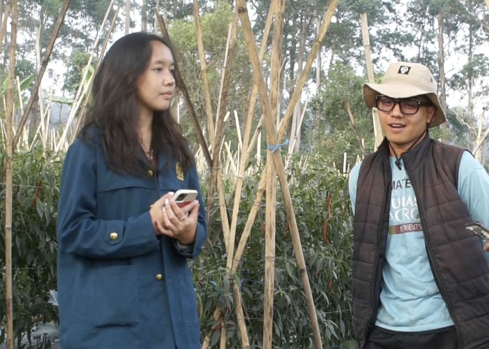

## Kompetensi target

Membangun desired state bersama target dan menghubungkannya dengan solution secara kredibel.

## Evidence wajib

- Current dan desired state milik person.
- Feature–benefit–value–outcome chain.
- Risk, evidence threshold, response, dan adaptation.

## Current dan desired state

**Target:** Narasumber petani yang diwawancarai saat sesi *user testing* lapangan NUSATANI.

**Current state:** Petani ini mengenal kesulitan menentukan tindakan perawatan tanaman hanya berdasarkan intuisi pribadi, dan ia secara eksplisit menyebut hal ini sebagai sesuatu yang "ribet" bagi petani muda yang belum punya pengalaman sebanyak petani senior.

**Desired state:** Kami ingin NUSATANI benar-benar dipublikasikan dan dipakai oleh petani, bukan berhenti sebagai purwarupa kompetisi. Secara spesifik, kami ingin melihat penurunan kasus gagal panen yang disebabkan oleh keterlambatan penanganan hama/penyakit dan kesalahan waktu pemberian pupuk/air, serta melihat semakin banyak petani muda yang merasa terbantu dan tidak lagi menganggap bertani sebagai pekerjaan yang terlalu rumit untuk dijalani.

## Feature–benefit–value–outcome chain

Monitor dan Panduan Tindakan → petani tahu kapan harus menyiram/memupuk → keterlambatan penanganan berkurang → gagal panen akibat faktor yang sebenarnya bisa dicegah menurun.

Lensa Tani → petani dapat mendiagnosis hama/penyakit lebih cepat lewat foto → penanganan dilakukan sebelum kerusakan meluas → gagal panen akibat hama/penyakit menurun.

Tanya AI → petani muda mendapat jawaban cepat tanpa menunggu penyuluh → bertani terasa tidak serumit yang dibayangkan → lebih banyak generasi muda bertahan sebagai petani, sehingga regenerasi petani membaik.

Kami tidak menyatakan rantai ini sebagai kepastian. Setiap panah adalah hipotesis yang baru bisa diuji kebenarannya setelah aplikasi benar-benar dipakai petani dalam jangka waktu tertentu, bukan hanya didemonstrasikan dalam sesi presentasi atau *testing* satu kali.

## Percakapan dan response

Pada sesi *user testing* lapangan, tim kami menjelaskan kepada narasumber petani bahwa jika aplikasi ini berhasil, ia akan benar-benar bisa membantu menyelesaikan masalah seperti gagal panen akibat keterlambatan penanganan dan kesulitan regenerasi petani muda.

> **Petani:** "Wah, ini kalau benar-benar bisa berhasil dan beneran ada, bisa membantu banget sih. Soalnya ini ribet juga kalau harus pakai intuisi sendiri, apalagi buat petani muda. Bakal ngebantu banget pokoknya."

Respons ini menunjukkan bahwa petani tersebut **memvalidasi** rumusan *desired state* kami dari sudut pandang pengguna nyata, bukan sekadar juri kompetisi. Ia menguatkan bahwa masalah "mengandalkan intuisi sendiri" memang terasa berat, khususnya bagi petani muda yang belum punya banyak pengalaman, sehingga tiga fitur kami memang menjawab kebutuhan yang ia rasakan sendiri.

Namun, saya perlu mengakui secara jujur bahwa respons ini adalah **validasi**, bukan **koreksi**. Petani ini tidak mempertajam atau mengubah definisi "berhasil" yang kami ajukan, berbeda dari pola ideal di mana target membantu memperjelas *desired state* lewat koreksi langsung, misalnya dengan mengungkapkan ukuran keberhasilan yang lebih spesifik dari sudut pandangnya sendiri. Ia menyetujui gagasan secara umum, tetapi kami belum menguji seberapa detail pemahamannya tentang "berhasil", misalnya berapa kali ia perlu memakai aplikasi ini sebelum ia sendiri menganggapnya berhasil.

## Risk dan evidence

Risiko utama adalah kesenjangan antara prototipe dan realitas penggunaan. Antusiasme petani pada sesi *testing* ini bisa jadi dipengaruhi oleh suasana wawancara yang positif (*social desirability bias*), bukan murni penilaian objektif terhadap kelayakan aplikasi. Petani yang menjadi target pengguna juga belum tentu memiliki perangkat dengan koneksi internet stabil, belum tentu terbiasa dengan antarmuka aplikasi modern, dan pemasangan sensor IoT di lahan membutuhkan biaya serta kemauan yang belum tentu dimiliki semua petani kecil.

*Safeguard* yang kami tawarkan: fitur Lensa Tani dan Tanya AI dirancang tetap bisa dipakai tanpa sensor IoT, seperti yang dianalisis pada portofolio Minggu 7, sehingga nilai aplikasi tidak bergantung sepenuhnya pada infrastruktur yang mahal.

*Evidence threshold* yang perlu dipenuhi sebelum klaim "menyelesaikan masalah gagal panen dan regenerasi petani" bisa dianggap valid: uji coba nyata dengan sekelompok petani selama minimal satu musim tanam, dengan data gagal panen dan tingkat penggunaan aplikasi yang terukur, bukan hanya respons antusias dari satu sesi wawancara singkat.

## Evidence dan refleksi

::: {.evidence-block}

Kontribusi saya: melakukan wawancara *user testing* langsung di lahan tanam, menyampaikan gagasan *desired state* aplikasi, dan mendokumentasikan respons narasumber.
:::

- Episode ini juga melanjutkan evidence dari portofolio Minggu 6 dan 7, yaitu tangkapan layar sesi final GEMASTIK XIX dan diagram arsitektur sistem NUSATANI.
- Kutipan petani di atas adalah rekonstruksi dari ingatan tim terhadap inti ucapannya, bukan transkrip kata per kata, karena sesi tersebut tidak direkam secara terpisah untuk kebutuhan tugas ini.
- AI (Claude) digunakan untuk membantu menyusun struktur portofolio dan mengelaborasi jawaban saya menjadi kalimat yang lebih runtut. AI tidak digunakan untuk mengarang koreksi *desired state* yang sebenarnya tidak terjadi; respons petani dinyatakan secara jujur sebagai validasi, bukan koreksi.
- *Next practice:* pada sesi *user testing* berikutnya, saya akan secara eksplisit menanyakan ukuran keberhasilan dari sudut pandang petani sendiri, misalnya "menurut Bapak/Ibu, kalau aplikasi ini bekerja dengan baik, hal konkret apa yang akan berubah dalam cara Bapak/Ibu bertani?", supaya *desired state* benar-benar teruji dan dikoreksi oleh pengguna, bukan hanya divalidasi secara umum.

## Self-assessment

| Dimensi | Skor | Evidence singkat |
| :--- | :---: | :--- |
| Person & Character | 4 | Target diperluas ke pengguna nyata (petani), bukan hanya juri kompetisi, dengan evidence foto lapangan |
| Objective & State | 3 | *Current* dan *desired state* dirumuskan jelas dan divalidasi dari sudut pandang pengguna |
| Repertoire, Language & AI | 3 | *Feature-benefit-value-outcome chain* disusun sebagai hipotesis, bukan klaim pasti; batas AI dinyatakan |
| Response & Adaptation | 2 | Diakui jujur bahwa respons petani bersifat validasi, bukan koreksi terhadap rumusan *desired state* |
| Agreement, Action & Relationship | 3 | *Evidence threshold* dirumuskan dengan mempertimbangkan risiko *social desirability bias* dari respons antusias narasumber |

**Total:** 15/20, Kompeten.

::: {.assessor-only}
### Assessment dosen

**Skor:** — / 20  
**Evidence yang mendukung:** —  
**Prioritas perbaikan:** —  
**Keputusan:** Belum dinilai / Perlu revisi / Tercapai
:::