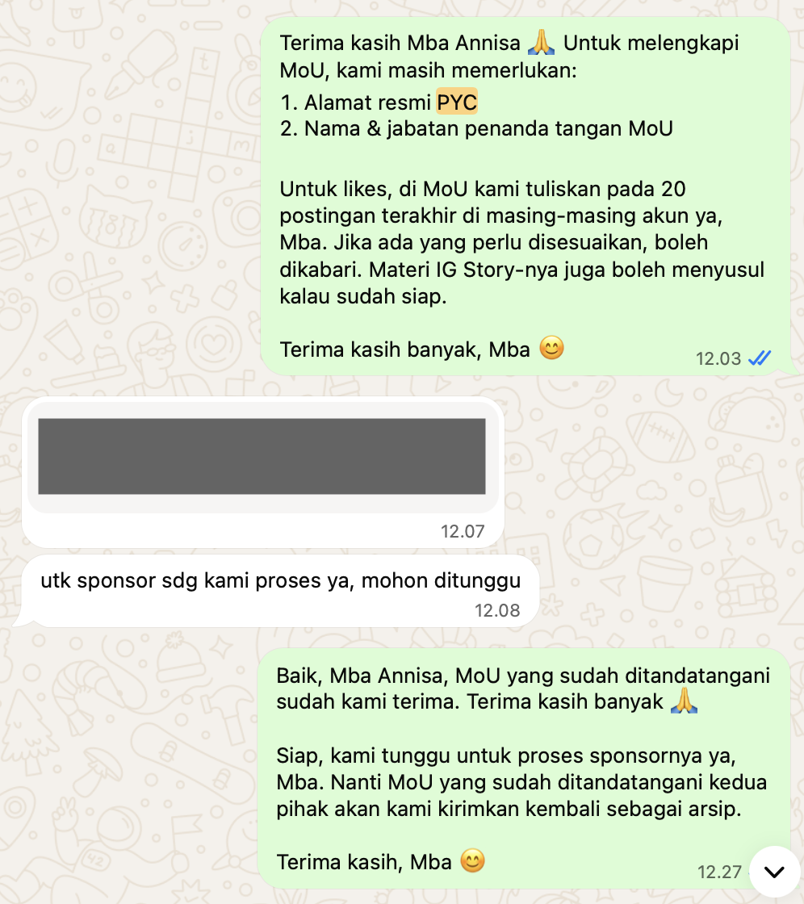

## Kompetensi target

Menemukan desire–action gap dan menghasilkan agreement yang feasible serta eksplisit.

## Evidence wajib

- Barrier dan authority map.
- Options dan trade-off yang dibahas.
- Agreement dengan owner/deadline serta bukti action atau review.

## Barrier dan authority map

**Konteks:** Negosiasi kontraprestasi sponsor dengan PYC (Purnomo Yus Gianto Center / PYC Community) untuk acara INFEST 2026, dalam kapasitas saya di divisi Funds and Sponsorship.

**Barrier:** Lingkup kontraprestasi berupa *follow* dan *likes* di Instagram belum jelas batasannya, yaitu apakah berlaku untuk seluruh unggahan PYC selamanya, atau terbatas pada unggahan tertentu selama periode kerja sama saja. Ketidakjelasan ini perlu diselesaikan sebelum draft MoU dapat difinalisasi dan ditandatangani kedua pihak.

**Authority:** Mba Annisa dari pihak PYC adalah kontak yang berwenang mengonfirmasi akun resmi yang harus di-*follow* dan di-*like*, menyetujui batasan lingkup kontraprestasi, serta menandatangani MoU atas nama PYC.

## Options dan trade-off

1. **Follow dan likes tanpa batas waktu di semua unggahan PYC:** paling menguntungkan sponsor, tetapi membebani tim secara berkelanjutan tanpa batas yang jelas, dan sulit diaudit kapan kewajiban dianggap selesai.
2. **Follow permanen, likes terbatas pada unggahan PYC selama periode kerja sama hingga 8 November 2026:** kewajiban tetap terpenuhi dengan batas waktu yang jelas, tetapi jumlah unggahan yang perlu di-*like* masih bisa bertambah terus selama periode tersebut, sehingga sulit dihitung di awal.
3. **Likes dibatasi pada jumlah unggahan tertentu (20 postingan terakhir) di masing-masing akun:** batasannya terukur sejak awal dan dapat langsung dituliskan di MoU sebagai kewajiban yang selesai begitu 20 unggahan itu di-*like*, tanpa bergantung pada rentang waktu yang bisa berubah-ubah.

Opsi ketiga akhirnya yang dituangkan dalam MoU, karena memberi kepastian jumlah yang dapat diselesaikan dan diverifikasi, dibandingkan opsi kedua yang masih bergantung pada tanggal dan berpotensi menimbulkan unggahan baru di tengah periode.

> "Untuk likes, di MoU kami tuliskan pada 20 postingan terakhir di masing-masing akun ya, Mba. Jika ada yang perlu disesuaikan, boleh dikabari."

## Agreement eksplisit

- **Scope:** *follow* permanen pada dua akun (@purnomoyusgiantorocenter dan @pyccommunity), *likes* dibatasi pada 20 postingan terakhir di masing-masing akun, dituliskan secara eksplisit dalam MoU Sponsorship INFEST 2026.
- **Owner:** saya bertanggung jawab menyusun dan mengirim draft MoU, meminta kelengkapan data (alamat resmi PYC, nama dan jabatan penanda tangan), serta mengelola proses penandatanganan dari pihak kami. Mba Annisa bertanggung jawab atas kelengkapan data dari pihak PYC dan proses penandatanganan dari pihak PYC.
- **Deadline:** materi IG Story disepakati boleh menyusul, tidak harus selesai bersamaan dengan MoU, sehingga penandatanganan MoU tidak terhambat oleh materi yang belum siap.
- **Evidence:** dokumen MoU bernama "Signed_730_MoU Sponsorship INFEST 2026 (PYC).pdf" yang telah ditandatangani kedua pihak.
- **Stop rule:** belum dirumuskan secara eksplisit dalam percakapan ini; ini menjadi catatan yang perlu saya perbaiki pada negosiasi berikutnya.
- **Review:** MoU yang sudah ditandatangani akan dikirim kembali kepada PYC sebagai arsip, dan proses sponsorship dari pihak PYC sedang berjalan ("utk sponsor sdg kami proses ya, mohon ditunggu"), menunjukkan ada tahap tindak lanjut yang masih dipantau kedua pihak.

## Action evidence dan adaptation

::: {.evidence-block}

Kontribusi saya: mengidentifikasi ambiguitas dalam lingkup kontraprestasi, mengusulkan batasan yang terukur (jumlah unggahan, bukan rentang waktu terbuka), meminta kelengkapan data yang diperlukan untuk finalisasi MoU, serta mengonfirmasi penerimaan dokumen yang sudah ditandatangani.
:::

**Adaptation:** Usulan awal saya pada percakapan sebelumnya adalah membatasi *likes* berdasarkan rentang waktu (hingga 8 November 2026). Setelah mempertimbangkan bahwa batasan waktu masih memungkinkan jumlah unggahan terus bertambah selama periode tersebut, saya mengubah usulan menjadi batasan jumlah unggahan tetap (20 postingan terakhir). Perubahan ini membuat kewajiban kontraprestasi menjadi lebih mudah diverifikasi dan diselesaikan, karena tidak lagi bergantung pada tanggal yang bisa berubah atau unggahan baru yang terus muncul.

Kesepakatan ini kemudian benar-benar dituangkan dalam dokumen MoU yang ditandatangani kedua pihak, bukan hanya berhenti sebagai percakapan lisan. Proses sponsorship dari pihak PYC juga dinyatakan sedang berjalan, menunjukkan bahwa kerja sama ini bergerak maju ke tahap pelaksanaan.

- AI (Claude) digunakan untuk membantu menyusun struktur portofolio dan analisis dari tangkapan layar percakapan yang saya berikan. AI tidak digunakan untuk mengarang isi dokumen MoU atau balasan yang tidak benar-benar terjadi.
- *Next practice:* pada negosiasi sponsor berikutnya, saya akan merumuskan *stop rule* secara eksplisit sejak awal, misalnya batas waktu maksimal jika salah satu pihak belum merespons kelengkapan dokumen, supaya proses tidak menggantung tanpa titik evaluasi yang jelas.

## Self-assessment

| Dimensi | Skor | Evidence singkat |
| :--- | :---: | :--- |
| Person & Character | 3 | Pihak sponsor eksternal dipetakan dengan otoritasnya yang jelas atas keputusan lingkup kerja sama dan penandatanganan MoU |
| Objective & State | 4 | Barrier (ambiguitas lingkup kontraprestasi) teridentifikasi dan berhasil diselesaikan hingga dituangkan dalam dokumen final |
| Repertoire, Language & AI | 3 | Usulan disampaikan secara sopan dan spesifik, dengan batasan yang terukur dan dapat diverifikasi |
| Response & Adaptation | 4 | Usulan awal (batas waktu) diubah menjadi batas jumlah unggahan setelah mempertimbangkan kelemahan opsi pertama |
| Agreement, Action & Relationship | 4 | Owner, Scope, dan Evidence eksplisit; MoU ditandatangani kedua pihak sebagai bukti tindakan nyata, bukan sekadar janji |

**Total:** 18/20, Kompeten.

::: {.assessor-only}
### Assessment dosen

**Skor:** — / 20  
**Evidence yang mendukung:** —  
**Prioritas perbaikan:** —  
**Keputusan:** Belum dinilai / Perlu revisi / Tercapai
:::